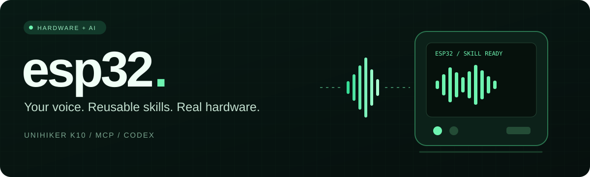

# ESP32 MCP



[](https://github.com/vb3227/esp32-mcp/actions/workflows/ci.yml)
[](https://github.com/vb3227/esp32-mcp/releases/latest)
[](LICENSE)

[Download firmware](https://github.com/vb3227/esp32-mcp/releases/latest) ·
[Installation](docs/INSTALL_BIN_RU.md) · [Claude / ChatGPT / Codex](docs/AI_CLIENTS_RU.md) ·
[Full setup](docs/MCP_SETUP_RU.md) · [Device drivers](docs/DEVICE_DRIVERS.md)

**Hardware tools, reusable skills and on-device Lua for MCP coding agents.**

Connect Codex, Claude or another MCP client to ESP32 over local Wi-Fi or an authenticated outbound relay. Run existing operations, compose saved skills, or upload Lua without rebuilding firmware. The default tools server needs no model key: your MCP client supplies the intelligence.

## Board profiles

| Hardware | PlatformIO environment | Features |
| --- | --- | --- |
| ESP32 DevKit | `esp32dev` | Lua, GPIO/ADC, I2C/SPI, JSON skills, direct/relay control |
| ESP32-S3 DevKit | `esp32s3` | Same core, board-specific pin policy |
| ESP32-C3 DevKit | `esp32c3` | Same core, board-specific pin policy |
| ESP32-C6 DevKit | `esp32c6` | Same core, board-specific pin policy |
| ESP32-S2 Saola | `esp32s2` | Same core, board-specific pin policy |
| ESP-WROVER-KIT | `esp32wrover` | Same core; PSRAM pins excluded from external policy |
| UNIHIKER K10 | `k10` | Core plus display, RGB, sensors, microphone/ASR, camera, photo/video and voice |

This project is independent. The K10 adapter retains the companion project's hardware features. Generic profiles do not acquire a camera, microphone or screen automatically. Other boards need a compatible Arduino target and a reviewed adapter/pin map. Compilation is distinct from physical validation: see [testing](docs/TESTING.md).

## Execution and persistence

API v3 adds background Lua tasks, status snapshots, task mailboxes and a catalog
of 32 concrete device drivers, including NRF24L01+. See [drivers and background
execution](docs/DEVICE_DRIVERS.md) for wiring examples and validation status.

| Runtime | Runs on | Storage | Use |
| --- | --- | --- | --- |
| JSON steps | Board | Host catalog, optionally board NVS | Hardware operations and compositions |
| Restricted Python | Laptop | Source/manifest and private JSON state | Computation and coordinated board calls |
| Lua 5.4.9 | Board | Host source/manifest, optionally board NVS | Local loops, GPIO and buses |

Lua has memory, source, instruction and time limits. GPIO is denied until explicitly allowed with `configure_device_pins`, within the board profile ceiling. Python excludes arbitrary imports, shell, files and sockets. Neither executor is a hardened hostile-code sandbox. New native drivers still require firmware changes. [Execution comparison](docs/EXECUTION_MODES_RU.md) · [Lua API](docs/NATIVE_LUA.md) · [Python API](docs/PYTHON_SKILLS.md).

## Prebuilt firmware

Download the release firmware ZIP, select the exact board profile and follow [binary installation](docs/INSTALL_BIN_RU.md). Public images contain no credentials; configure Wi-Fi/tokens over USB after flashing, without rebuilding. Factory images are for initial installation; app-only updates preserve NVS when the partition layout is unchanged.

## Start

1. Install Python 3.11/3.12, VS Code and PlatformIO. Copy `include/board_config.example.h` to ignored `include/board_config.h`; enter your Wi-Fi and two independent random tokens.
2. Review `MCP_ALLOWED_PINS` against your board pinout. Empty means all external pin access is denied.
3. Select the matching environment from the table, build and upload. Chip variants require different binaries; do not flash the default ESP32 image to S3/C3/C6/S2. K10 uses **k10**, not default esp32dev.
4. Install requirements and configure the MCP client:

```powershell
python -m venv .venv
.venv/Scripts/python.exe -m pip install -r requirements.txt
$env:ESP_MCP_CONNECTION = 'direct'
$env:ESP_MCP_BOARD_URL = 'http://192.0.2.1:8765'
$env:ESP_MCP_BOARD_TOKEN = 'REPLACE_WITH_BOARD_TOKEN'
.venv/Scripts/python.exe server.py --check
```

The IP is a documentation placeholder. `--check` validates configuration without contacting hardware. For bare ESP32 use [Codex TOML](config/mcp.example.toml) or [Claude JSON](config/claude.example.json). For K10 use [Codex K10](config/k10.mcp.example.toml) or [Claude K10](config/k10.claude.example.json), replacing paths and tokens locally. MCP uses stdio; logs go to stderr. Host ports default to 8777/8778. Do not expose unencrypted device HTTP publicly.

Full Russian guide: **[Installation and connection](docs/MCP_SETUP_RU.md)**.

## MCP tools

- `native_api_reference`: get all native function signatures without reading source.
- `scan_wifi_networks`: scan on the board and return a native job ID.
- `configure_device_pins`: persist an exact external GPIO allowlist without reflashing.
- `hardware_capabilities`: inspect the connected board profile before selecting operations.
- `execute_device_code(source="return 6 * 7")`, then `device_code_status(job_id=...)`: execute Lua on the MCU.
- `save_device_script`: save source, short command and aliases; optionally install/run on the board.
- `list_device_scripts`, `read_device_script`, `run_device_script`, `stop_device_code`: control persistent native skills, including reading source back from the device.
- `save_device_skill`, `run_composed_skill`, `match_saved_command`: reuse and parameterize JSON skills without duplicates.
- `save_python_skill`, `run_python_skill`, `python_skill_status`: run restricted laptop programs.

Local save and successful NVS installation are separate outcomes. Installed Lua skills survive reset but do not auto-run at boot. An active job continues after host disconnection until completion/deadline. Four Lua slots and four K10 hardware slots are separate pools sharing one MCU; memory and peripheral contention can reject work.

## Optional K10 voice and media

`server.py --voice` enables A → speak → A capture, local or Groq STT, saved-skill routing and Codex generation. Add `--local-stt` and install [local dependencies](requirements-local-stt.txt) for local recognition. Credentials stay on the laptop. The vendor local-ASR wake phrase remains a hardware compatibility constant; the generic core does not depend on it.

K10 preserves local-command priority, transcripts, the green activity overlay, hardware jobs, camera preview, still photos and bounded silent AVI saving. B remains available. No continuous surveillance or video/person analysis is included. [Feature matrix](docs/BOARD_PROFILES.md).

`server.py --gateway-only --profile generic` runs an independent owning service. Avoid competing gateways on the same ports. K10 uses `--profile k10`; generic mode omits camera/voice/display UI tools. Direct-mode photo/video still needs a reachable gateway URL and matching upload token. Cross-network operation uses outbound WSS, one board per gateway.

K10 startup displays the same gray-to-green eye animation as the companion firmware, stage percentages and `by vb3227`. Headless profiles report initialization on Serial.

## Source and checks

```text
server.py                 Public MCP entry
src/core/                 Lua runtime and relay
src/boards/generic/       ESP32 supervisor
src/boards/k10/           K10 hardware/voice/media adapter
include/                  Headers and public configuration template
lib/lua/                  Upstream Lua and provenance
mcp/                      Host tools and optional voice services
skills/                   Saved JSON/Python/Lua programs
config/                   Client templates with placeholders
 docs/                    Setup, APIs and limits
 tests/ and scripts/      Tests and explicit source packaging
```

```powershell
python -m pip install -r requirements-dev.txt
python -m unittest discover -s tests -t . -v
python scripts/check_repository.py
python scripts/package_source.py
```

Packaging explicitly selects sources, excluding credentials, runtime data, captures, caches, firmware and build output. Review the resulting archive. [Security](SECURITY.md) · [Contributing](CONTRIBUTING.md) · [Architecture](docs/ARCHITECTURE.md).

Author: **vb3227**. Original project code is [MIT licensed](LICENSE).
Bundled components retain their [upstream licenses](THIRD_PARTY_NOTICES.md).
