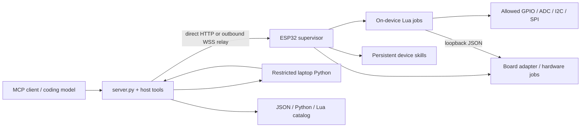

# Architecture

`src/core` supplies the bounded native runtime and relay. `src/boards/generic` owns the Arduino network supervisor and core JSON operations. `src/boards/k10` owns vendor hardware, voice arbitration, display and media, without a dependency on another checkout.

Default tools mode is model-free. The connected MCP client generates new programs. Optional voice mode captures a WAV, transcribes once, checks an in-memory skill catalog and uses a lightweight router; Codex is reserved for novel programs. Exact aliases/compositions avoid generation. Native Lua, host Python and existing JSON actions have explicit execution locations.

Board and gateway tokens are separate. Local host control uses a third private control token. Public relay traffic cannot invoke the Python control endpoint directly. HTTP/JSON/body/queue limits apply before dispatch. Uncertain network actions are not automatically replayed.

Four Lua slots are distinct from K10's four hardware slots and host Python workers; all share real hardware and finite memory. Admission/arbitration can reject work. Persistent files/NVS do not imply automatic boot execution or resumed in-flight jobs.
